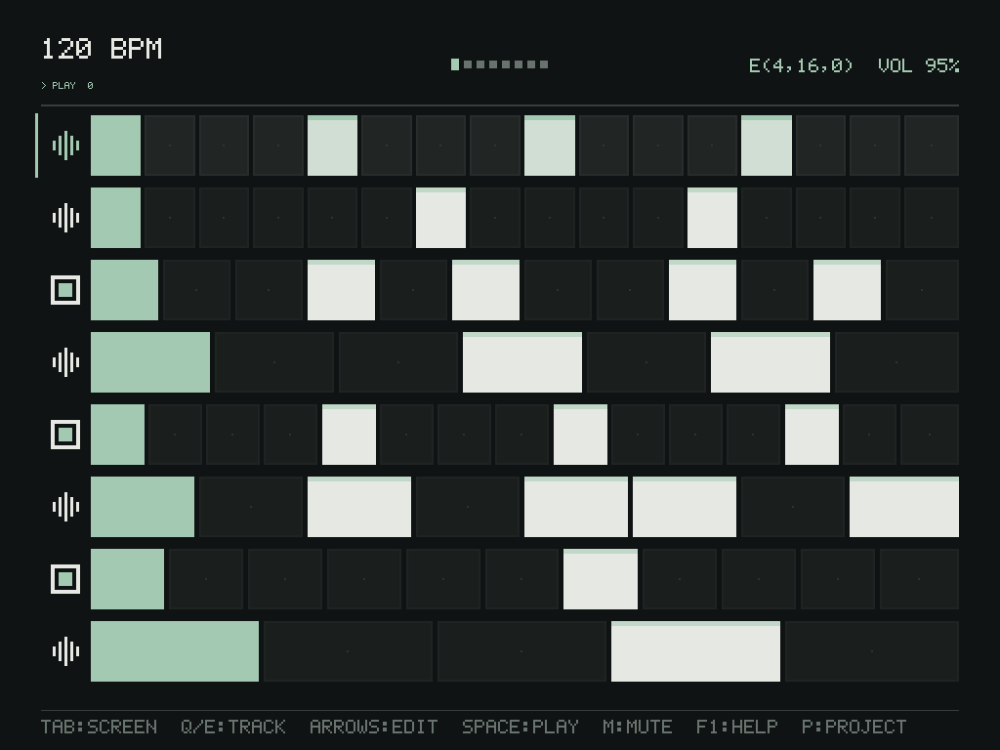
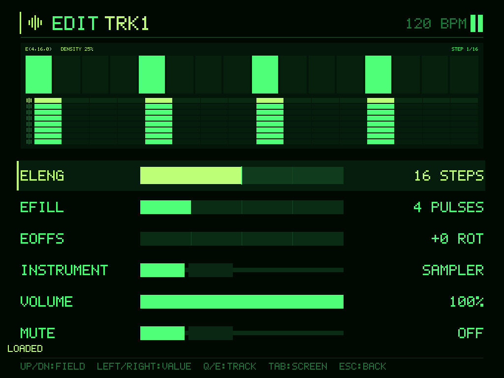
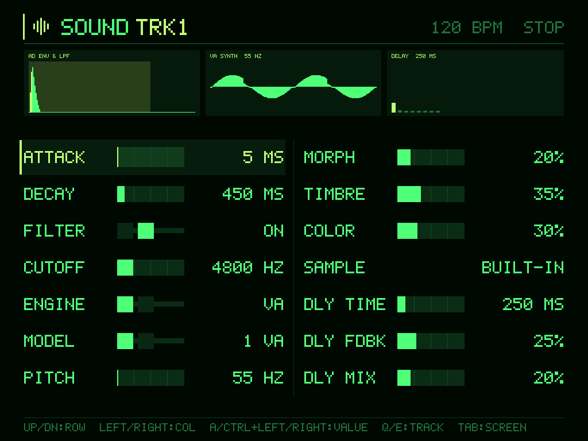
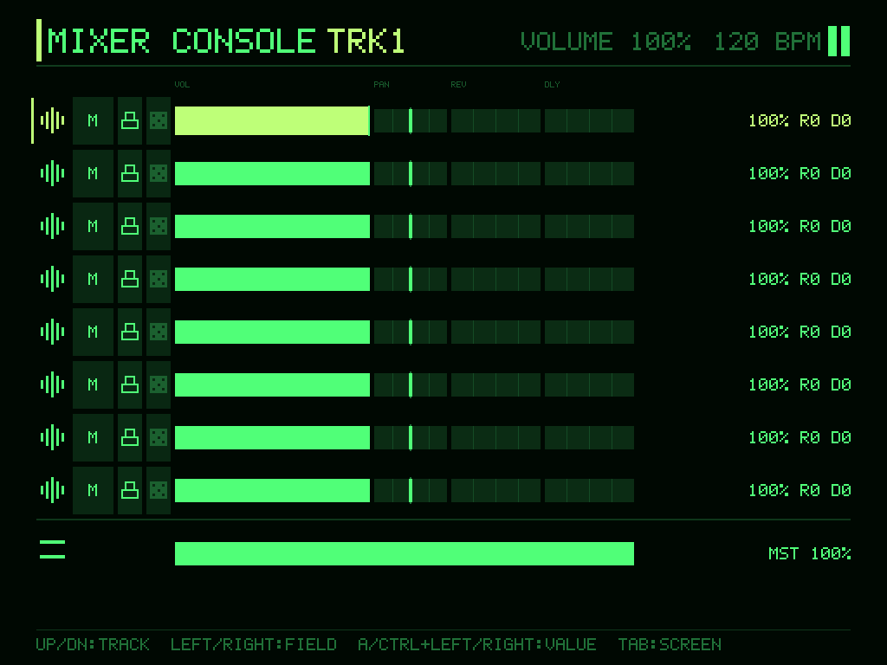
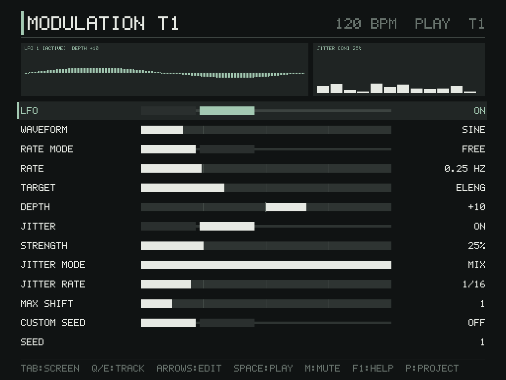
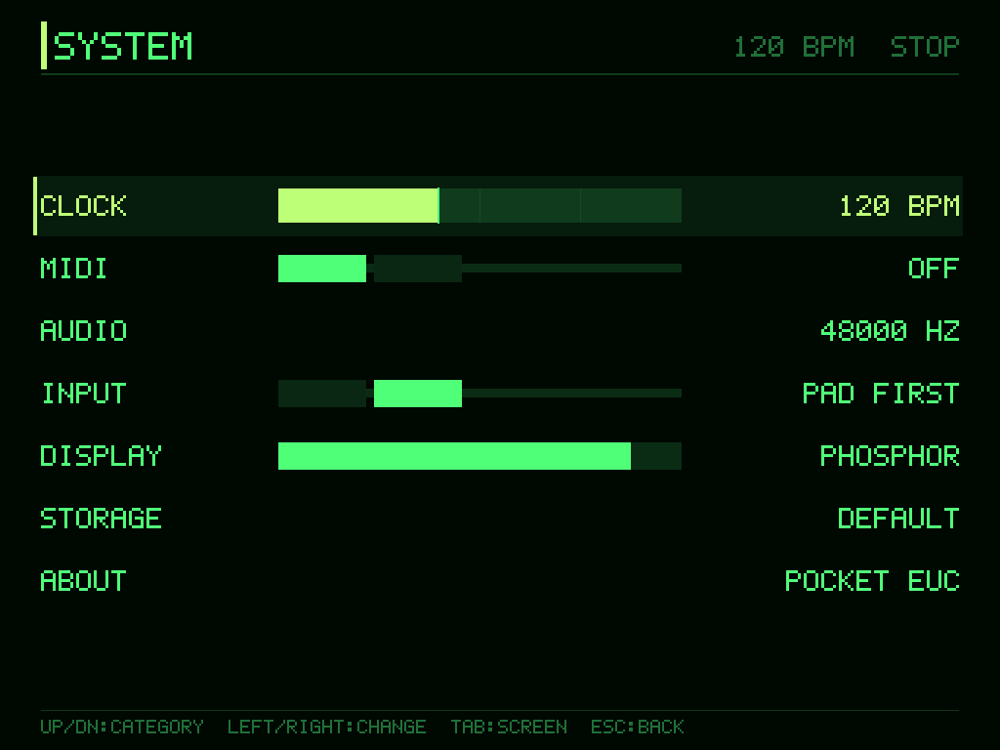

# Pocket Euclidean
As of October 26, 2026, it is up and running. I'm not satisfied with the UI. There are still a lot of parts that haven't been implemented yet.
But I've run out of credits to use for coding!!!!!

Pocket Euclidean is an original C++17 groovebox project for desktop systems
and retro handhelds. It targets an eight-track Euclidean sequencer with a WAV
sampler and replaceable lightweight synthesizer voices. TrimUI Brick Pro /
NextUI / PortMaster is the first handheld target under consideration; other
Linux handhelds and desktop systems remain part of the portability design.

## UI Screenshots (Pure Geometric Tile Matrix & Abstract Instrument Icons)

Each track's Euclidean step bar stretches elastically to 100% of the lane width regardless of step count (`ELENG` 2..32), and both active pulse steps and non-pulse rest steps share an **identical full-row vertical height**, forming an edge-to-edge geometric tile matrix. Left-column text clutter (`T1..T8`, `E(...)`) is replaced with minimal abstract geometric instrument glyphs (5-bar symmetrical wave spectrum for **Sampler**, concentric square frame + core for **Synth**, and horizontal mute cut for muted tracks).

| MAIN (Elastic Polymetric Grid) | EDIT (Step Explorer & 8-Track Phase Matrix) |
| :---: | :---: |
|  |  |
| **SOUND (AD / LPF / VA Synth / Delay Visualizer)** | **MIXER CONSOLE (8-Ch Level & Pan Field)** |
|  |  |
| **MODULATION (LFO Cycle & Jitter Scatter)** | **SYSTEM (Clock / MIDI / Display Theme)** |
|  |  |

## Project status

The repository currently provides a portable sequencer and modulation core,
sampler/synth rendering path, mixer DSP, fixed-size audio/UI event queues,
logical UI state/input handling, and platform interface contracts. The SDL2
desktop shell renders all six screens, runs audio through SDL, saves and loads
versioned projects and settings, and supports per-track WAV selection.
Remaining gaps include device packaging, deeper effects routing, Save As /
missing-sample recovery flows, and measured performance on target hardware.

Build and test status is deliberately conservative. The portable core and both
CTest executables have been built and run on Windows x86-64 with LLVM-MinGW
Clang 23.1.3 and Ninja; all tests passed. SOUND (MODEL / SAMPLE), the SELECT WAV
browser, project v9 sample restore, and a live sample swap during playback were
also checked with GUI captures. This still does not verify audible quality,
long-run stability, or any handheld. No handheld runtime is claimed as verified.
The current Brick Pro ABI, compiler, sysroot, SDL2 runtime, controller mapping,
audio behavior, storage, and PortMaster/NextUI compatibility all require target
validation.

## Getting started

Use a desktop C++17 compiler and CMake. From a Visual Studio 2022 Developer
PowerShell, build and run the tests with MSVC:

```powershell
cmake -S . -B build\windows -G "Visual Studio 17 2022" -A x64
cmake --build build\windows --config Debug
ctest --test-dir build\windows -C Debug --output-on-failure
```

For another native Windows compiler with Ninja, set
`CMAKE_CXX_COMPILER` to that compiler's full path. For example:

```powershell
cmake -S . -B build\windows-ninja -G Ninja `
  -DCMAKE_CXX_COMPILER:FILEPATH="C:\toolchain\bin\x86_64-w64-mingw32-clang++.exe"
cmake --build build\windows-ninja
$env:PATH = "C:\toolchain\bin;$env:PATH"
ctest --test-dir build\windows-ninja --output-on-failure
```

The compiler's runtime DLL directory must be on `PATH` when running MinGW-built
test executables. Do not use a handheld cross-compiler for a native Windows
build.

If `pocket_euclidean_tests.exe` does not start from Explorer on Windows, launch
it from a terminal where the matching toolchain runtime is on `PATH`:

```powershell
$env:PATH = "C:\toolchain\bin;$env:PATH"
.\build\windows-ninja\pocket_euclidean_tests.exe
```

`0xc0000135` usually means a required runtime DLL is not visible.

## Desktop shell target (Phase 2 baseline)

`pocket_euclidean_app` is now available as an application-shell target:

- with SDL2 detected by CMake: opens a resizable window, maps keyboard /
  controller inputs to logical actions, cycles all six UI screens, and renders
  bounded 2D primitives (MAIN pattern bars and simple per-screen rows);
- without SDL2: starts in headless fallback mode and prints a clear message.

Examples:

```powershell
.\build\windows\Debug\pocket_euclidean_app.exe --headless
.\build\windows\Debug\pocket_euclidean_app.exe --width 1024 --height 768
# 1フレームだけ描画してBMP保存（画面確認用。--screen 0-5、--help-modal も指定可）
.\build\windows\Debug\pocket_euclidean_app.exe --screen 1 --capture edit.bmp
# 起動直後から再生（音声デバイスが開ければ音声クロック駆動）
.\build\windows\Debug\pocket_euclidean_app.exe --play
# フォルダ内の *.wav を名前順にトラック1〜8へ読み込む（起動時、音声開始前）
.\build\windows\Debug\pocket_euclidean_app.exe --play --samples C:\path\to\wavs
```

`--data <dir>`（既定 `./conf`）の `project.pec` に、Project menu（Select）の SAVE／LOAD／NEW で保存・読み込みできます。起動時に存在すれば自動で読み込みます。プロジェクト形式はv9で、トラックごとのPlaitsモデルとサンプルパスを保存します（v6–v8は読み込み時に移行）。プロジェクトファイル名のSave Asはまだなく、1スロットのみです。SOUND画面のSAMPLE行でSELECT WAVブラウザを開き、トラック別にWAVを選択できます。同じディレクトリの `settings.cfg` にはテーマとマスター音量などが自動保存されます。

```powershell
# ハンドヘルド向けの起動オプション: 全画面、音声レート／バッファー指定。
# コントローラーの Select+Start 同時押しで終了。`.\samples` があれば自動で読み込む。
.\build\windows\Debug\pocket_euclidean_app.exe --fullscreen --rate 44100 --buffer 512
```

### PortMaster（Linux AArch64）向けクロスビルド

WSL／Linux 上で、zig をツールチェーンにしてルート権限なしで aarch64 向けにビルドし、PortMaster 用 zip まで作ります（要: cmake、ninja、curl、python3、`~/tools/zig/zig` に zig 0.14.x、または `ZIG=` で指定）。

```sh
scripts/build-portmaster-aarch64.sh   # 成果物: ~/pocket-portmaster-build/dist/pocketeuclidean.zip
```

対象 glibc は既定 2.28（`GLIBC=` で変更）。SDL2 はリンク用にソースからビルドするだけで、実機では端末側の libSDL2 を使います（リンク用 SDL2 は `SDL_*` のみ公開するよう制限し、zig の compiler-rt をアプリに埋め込ませています）。R36S では初版が `__aarch64_ldadd8_relax` の未解決で起動しなかったため修正済みですが、修正版の実機動作は未確認です。

Other desktop platforms can use the same CMake targets with their native
C++17 compiler:

```sh
cmake -S . -B build/desktop
cmake --build build/desktop
ctest --test-dir build/desktop --output-on-failure
```

Builds should use a separate build directory per compiler, target ABI, sysroot,
and feature configuration. The ARM toolchain files are templates only; they
do not include a compiler SDK, sysroot, or target libraries. In particular,
`cmake/toolchains/linux-armhf.cmake` is for 32-bit ARM hard-float Linux and is
not the Brick Pro target. Brick Pro is expected to use a compatible AArch64
userspace, subject to verification.

## Handoff guide

For work by another developer or coding agent, read the documents in this
order:

1. [docs/STATUS_AND_ROADMAP.md](docs/STATUS_AND_ROADMAP.md) — agreed scope,
   implementation status, verified/unverified items, and prioritized next
   work. Treat this as the current project handoff and status summary.
2. [docs/ARCHITECTURE.md](docs/ARCHITECTURE.md) — ownership boundaries,
   real-time constraints, audio parameter handoff, and core interfaces.
3. [docs/PLATFORMS.md](docs/PLATFORMS.md) — build families, target ABI and
   device validation gates.
4. [docs/UI_CONTROLS.md](docs/UI_CONTROLS.md) and
   [docs/UI_DESIGN_POLICY.md](docs/UI_DESIGN_POLICY.md) — logical controls,
   current UI behavior, and rendering requirements.
5. [docs/DECISIONS.md](docs/DECISIONS.md) — temporary defaults and unresolved
   product/engineering decisions.

Before changing code, check these constraints:

- Keep core code independent of SDL, operating-system APIs, and a particular
  handheld. Put platform integration behind the existing interfaces.
- The audio callback must not allocate, block, perform file I/O, or access UI
  state concurrently. Check the queue and event-transfer lock-free
  requirements before opening a device.
- `AudioParameterQueue` currently transfers track volume, pan, mute, Attack,
  Decay, filter enable/cutoff, and master volume at callback block boundaries.
  Rhythm, tempo, instrument assignment, modulation, and other sequencer
  mutations are not yet safe to make concurrently with playback.
- Keep buffers, voices, decoded samples, and queues bounded. Use the platform
  resource budgets as profiling gates, not as evidence of measured performance.
- Separate implementation, compilation, automated-test execution, and
  on-device validation in status reports. Never describe an unrun test or
  unverified device as successful.

## Build families

Native desktop builds use CMake and the host compiler. Linux handheld
cross-builds use a device-compatible compiler and sysroot with the templates
under `cmake/toolchains/`. The templates are starting points, not certified
toolchains; see [docs/PLATFORMS.md](docs/PLATFORMS.md) before configuring a
target build. A successful cross-build does not establish runtime
compatibility.

## Product and design references

- [docs/STATUS_AND_ROADMAP.md](docs/STATUS_AND_ROADMAP.md) is the canonical
  status/roadmap document.
- [docs/ARCHITECTURE.md](docs/ARCHITECTURE.md) describes state ownership and
  audio/UI/platform boundaries.
- [docs/UI_CONTROLS.md](docs/UI_CONTROLS.md) describes logical controls and
  testable UI behavior.
- [docs/UI_DESIGN_POLICY.md](docs/UI_DESIGN_POLICY.md) describes the visual
  language and renderer acceptance criteria.
- [docs/DECISIONS.md](docs/DECISIONS.md) records design defaults and open
  questions.
- [docs/PLATFORMS.md](docs/PLATFORMS.md) describes cross-build and hardware
  validation requirements.
