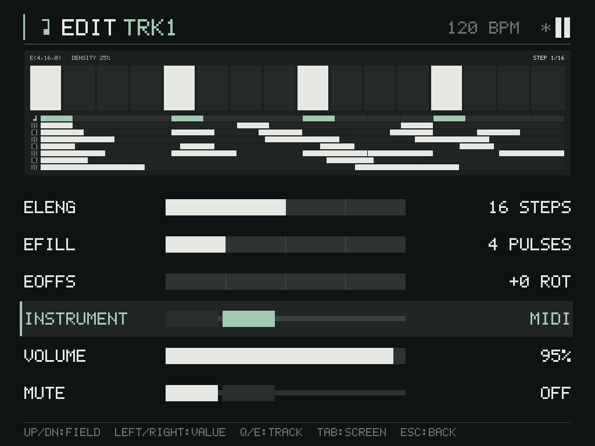
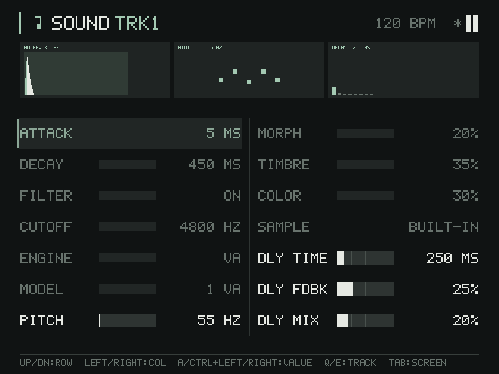
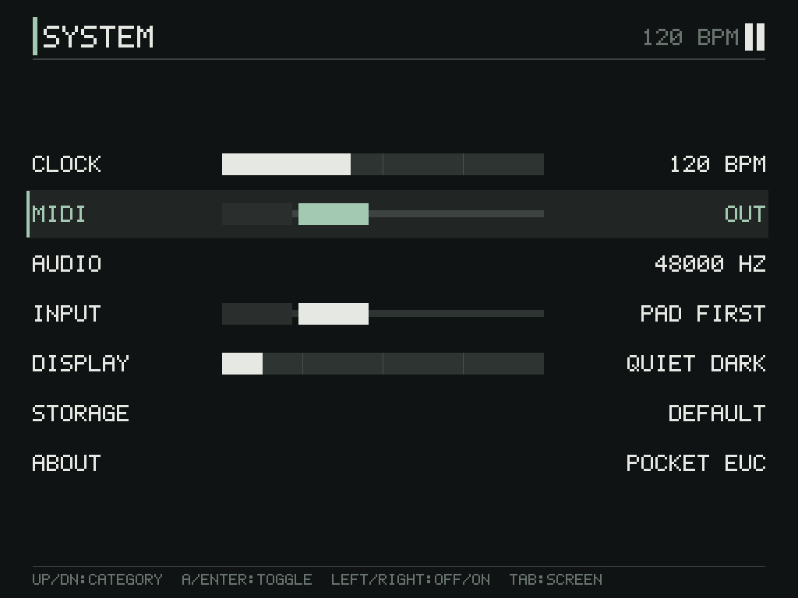

# MIDI

## 現在の範囲

Windows デスクトップビルドで、MIDI の入力と出力を利用できる。

- MIDI Clock In とトランスポート入力（Start / Stop / Continue）。
- マスター BPM に追従する MIDI Clock Out（F8）。トランスポート停止中も常時送出する。
- トラックのサウンドエンジンとして MIDI を選択でき、トリガーを Note On / Off として出力する。
- MIDI 入力の ON/OFF、入出力チャンネル、ポート番号は SYSTEM 設定に保存する。
- MIDI 未接続・未設定でも standalone groovebox として動作する。
- Linux / PortMaster ビルドは null backend で、SYSTEM の MIDI カテゴリを表示しない。
- CC マッピング、MIDI Learn、入力ノートによる発音は未実装。

## 構成

```
WinMM callback ──timestamp──> bounded SPSC ring (256)
                                      │
                           UI thread poll (every frame)
                                      │
                          MidiClockFollower (24 PPQN)
                              │                  │
                     transport latch        tempo estimate
                              │                  │
                    Sequencer restart/      Sequencer::setTempo
                    resume/stop                  │
                              └── SequencerSync ──> audio thread
                                                       │
                                    MidiClockGenerator (24 PPQN)
                                    Note On/Off, Start/Stop/Continue
                                                       │
                                                IMidiBackend::send
                                                       │
                                                  WinMM midiOut
```

- `platform::IMidiBackend` が OS 依存を隔離する。イベントは
  `MidiEvent::timestampMicros`（`steady_clock` の µs、0 は未設定）を持つ。
- `app::SystemMidiBackend` は Windows で WinMM の `midiInOpen` /
  `midiOutOpen` を使う。入力と出力は独立にオープンし、片方しか無い
  ポートでも利用できる。`hasInput()` / `hasOutput()` で状態を公開する。
- コールバック内では確保・ブロック・ログ出力をしない。リングが満杯の場合は
  イベントを破棄する。
- `sequencer::MidiClockFollower` と `sequencer::MidiClockGenerator` は
  OS 非依存で、確保もブロックもしない。

## MIDI 楽器（Note Out）

トラックの `InstrumentType` は `Sampler` / `Synth` / `Midi` の3値。
EDIT の INSTRUMENT 行で Left/Right または Confirm により
`SAMPLER → SYNTH → MIDI → SAMPLER` と循環する。

- MIDI トラックは内部のサンプラー／シンセvoiceをレンダリングしない。
  既存の発音は楽器変更時に停止する。
- ノート番号は `synth.pitchHz` と Turing の半音オフセットから算出する
  （A4 = 440 Hz = 69、0–127 にクランプ）。
- ベロシティはトラック Volume（0–100）を 1–127 に対応させる。
  Volume 0 とミュート中のトラックは Note On を送らない。
- チャンネルは `settings.midi.outputChannel` を基準に、トラック N が
  `base + N`（16 で折り返し）。既定は TRK1→ch1 … TRK8→ch8。
- ゲート長はステップ長の 50%。Note Off は次のブロック境界で送出する。
- モノフォニック（1トラック1ノート）。同じトラックで次のトリガーが来た
  場合は、前のノートを Note Off してから Note On する。
- 停止・ミュート・Volume 0・楽器変更・MIDI 出力の無効化では、保持中の
  ノートをすべて Note Off する。

SOUND 画面では MIDI トラックの PITCH のみ編集できる。ATTACK / DECAY /
FILTER / CUTOFF / ENGINE / MODEL / MORPH / TIMBRE / COLOR / SAMPLE は
subdued 表示の読み取り専用。DLY TIME / FDBK / MIX はグローバル効果として
引き続き編集できる。SOUND のビジュアライザは `MIDI OUT` と5ピン風の
ドットで外部出力を示す。

## クロック出力

- 24 PPQN。`MidiClockGenerator` がオーディオスレッドでブロック単位にパルスを
  生成するため、UI フレームレートに依存しない。送出はオーディオブロック境界に
  量子化される。
- テンポはマスター BPM（`Sequencer::tempo()`）。20–400 BPM にクランプする。
- トランスポート停止中も F8 を送り続ける。外部機器のテンポ同期や
  アルペジエーターのクロックとして使える。
- サンプルレート変更時は位相をリセットする。
- Start / Stop / Continue は `transportRevision` の変化に追従して送出する。
  Start は先頭から、Continue は現在位置から再開する。

## 画面

1024×768 のキャプチャ。640×480 でも同じ行構成で表示できることを確認済み。

| EDIT（MIDI 選択） | SOUND（MIDI トラック） | SYSTEM（OUT） |
| --- | --- | --- |
|  |  |  |

## テンポ追従（Clock In）

- 24 PPQN のクロック間隔を直近 24 区間の平均から BPM に変換する。
- 40–240 BPM にクランプする。
- 2 ms 未満または 250 ms 超の間隔、および平均の 3 倍／1/3 未満の外れ値では
  履歴をリセットし、推定値を曲げない。
- 最初の有効な推定値は必ず 1 回通知する。以降は 0.05 BPM 以上の変化で通知する。
- UI スレッドが `Sequencer::setTempo` を呼び、`SequencerSync` が音声側へ
  既存のテンポ差分コマンドとして伝える。

## トランスポート

| MIDI | Sequencer | 意味 |
| --- | --- | --- |
| Start | `restart()` | 先頭（tick 0）から再開 |
| Continue | `resume()` | 現在位置を保持して再開 |
| Stop | `stop()` | 停止。位置は保持 |

- Start / Stop / Continue はラッチされ、UI フレームごとに最新の 1 件を消費する。
  Start は保留中の Stop / Continue を打ち消す。
- `Sequencer` は単調増加する `transportRevision` を持ち、`SequencerSync` は
  play フラグの一致ではなく revision の変化で Start / Continue / Stop を判定する。
  これにより、フレーム間に再生状態が元へ戻ってもエッジが失われない。
- Clock パルスはテンポ推定にのみ使い、ステップの直接スケジュールには使わない。
  トランスポートは Start 受信時に即座に開始する。

## 設定

`settings.cfg` は `SystemSettings` v4。

```
PocketEuclideanSettings
version 4
tempo 120
audio 48000 256 100
input 1 350 120
midi <enabled> <inCh> <outCh> <deviceIndex>
theme 0
```

- v2 / v3 ファイルは MIDI 無効・入力チャンネル 1・デバイス 0 で移行する。
- `deviceIndex` は 0–15。存在しないポートを指定した場合は開けない。
- 入力の有効化はプロジェクトの dirty state を変更しない。
- `outCh` は Note Out の基準チャンネル。MIDI 楽器のトラック番号を加算する。

## SYSTEM 画面

- CLOCK の次が MIDI。Left / Right で OFF / ON を切り替える。Confirm / A でも
  トグルできる。
- 表示は `OFF`、入力と出力の両方が開けば `IN+OUT`、入力のみ `IN`、
  出力のみ `OUT`、有効だがどちらも開けない場合 `NO DEV`。
- ポートが後から現れる場合に備え、開けない間は 2 秒ごとに再試行する。

## コマンドライン

```text
pocket_euclidean_app.exe --midi-list
pocket_euclidean_app.exe --midi-device 1
```

- `--midi-list` は入力ポートと出力ポートを `index: name` 形式で表示して終了する。
- `--midi-device` は設定ファイルの `deviceIndex` より優先する（0–15）。

## テスト

`pocket_euclidean_tests` に以下を含む。

- 120 BPM / 125 BPM のクロック推定とテンポ変更のラッチ。
- 長い空白・外れ値による履歴リセット。
- Start / Stop / Continue のラッチと Sequencer の位置保持。
- `SequencerSync` の Start / Stop / Continue コマンド生成。
- `MidiClockGenerator` が 120 / 60 / 240 BPM で 48 / 24 / 96 パルス／秒を
  ブロック境界をまたいで生成すること。
- Hz→ノート番号（Turing オフセット・クランプ）と Volume→ベロシティの変換。
- `AudioCallbackProcessor` が停止中も F8 を出し続け、16/16 の MIDI トラックで
  1 小節に 8 ノート（Note On/Off 各 8）を送り、ピッチが正しいこと。
- 設定 v4 の往復、v2 / v3 からの移行、将来バージョンの拒否。

`pocket_euclidean_ui_tests` は楽器の3値サイクル、MIDI トラックの PITCH 編集可、
ATTACK / ENGINE の読み取り専用、SYSTEM MIDI トグルと dirty state 非変更を
確認する。

## 既知の制限

- Windows のみ実バックエンドを持つ。
- 実 MIDI 機器が無いため、クロックの実機精度、外部機器の追従、Note On/Off の
  聴感は未検証。
- 入力ノートの発音、CC マッピング、MIDI Learn、複数出力ポートの同時利用は
  未実装。
- クロック入力が Stop なしで途切れた場合のタイムアウト停止は未実装。
- 複数入力ポートの同時利用、ホットプラグ時の自動再選択は未実装。
- 機器ごとのクロック揺らぎ・レイテンシーは実機で未計測。
